**PC-Grade Hardware `KeyEvent` Keyboard • Persistent Floating Deck • Analog Mouse Joystick**

[Important Note](#-important-note) •
[OTG Mechanical Feel](#-how-it-works-just-like-a-usb-otg-keyboard--mouse) •
[5 Modes](#-5-instant-switch-modes) •
[Shortcuts](#-hardware-os-shortcuts) •
[Mouse Joystick](#-mouse-joystick--mcpe-look) •
[Customization](#-themes-gif-wallpapers--kdb-profiles)

---

## ⚡ How It Works (Just Like a USB OTG Keyboard & Mouse)

> Our KBD board works the same way as when you connect a mechanical keyboard and mouse to your phone with an OTG. It works and inputs the exact same like that—just still a few things are limited, mostly the real mechanical feel that you won't ever feel on touch glass. Android won't even know whether you connected a physical mechanical keyboard or not; our app sends hardware signals straight to the inputs the same way a mechanical keyboard does, not like other basic mobile keyboard apps that only input plain text.

That means **Termux**, **code editors**, **remote desktops**, and **PC-keyboard-supported mobile games** react to <kbd>Ctrl</kbd>, <kbd>Alt</kbd>, <kbd>Win</kbd>, <kbd>F1</kbd>–<kbd>F12</kbd>, hold-down `WASD`, and arrow keys cleanly right off your screen.

---

> [!IMPORTANT]
> ### 📌 Important Note
> - Enable and select **KeyDeck** as your IME *to use the IME (Normal keyboard) version.*
> - Enable and select **KeyDeck IME** and open the **Floating Keyboard** *to use it in any area's input across apps.*
> - Enable **Accessibility** *to use the keyboard's Game mode Mouse Pad / Joystick on screen.*
>
> `This keyboard is made for Mobile Developers and Mobile Gamers who want better control over mechanical-keyboard-supported Games and Dev-related apps (e.g., Termux, SSH clients, code editors).`

---

## ✨ Core Highlights at a Glance

| Feature | What You Get |
| :--- | :--- |
| **Hardware Signals** | Paired `ACTION_DOWN` / `ACTION_UP` `KeyEvent` dispatch (`SOURCE_KEYBOARD`) with full modifier bitmasks |
| **5 Instant Modes** | Switch live between `PC+Num`, `PC Full`, `Simple`, `Num`, and `Game` from the top strip |
| **Game Mouse Joystick** | Hybrid circular analog stick + trackpad with 60Hz panning, floating cursor pointer, and MCPE look mode |
| **Floating + System IME** | Draggable, resizable transparent overlay with automatic system-IME suppression when expanded |
| **Themes & `.kdb` Export** | 12+ Neumorphic themes, animated GIF wallpapers, and one-file `.kdb` backups (`@version:117`) |

---

## 🎛️ 5 Instant-Switch Modes

Click any section below to expand full details:

<b>🖥️ PC+Num &amp; PC (Full) — Desktop Layouts &amp; Hold-to-Repeat</b>

- **PC+Num**: Compact 10-column QWERTY paired with a live 4×5 numeric keypad and <kbd>NumLock</kbd> toggle (switches between digits and <kbd>Home</kbd> / <kbd>End</kbd> / <kbd>PgUp</kbd> / <kbd>PgDn</kbd> / Arrows).
- **PC (Full)**: 6-row desktop QWERTY featuring <kbd>Esc</kbd>, toggleable <kbd>F1</kbd>–<kbd>F12</kbd> Function Row, <kbd>Tab</kbd>, <kbd>Caps</kbd>, <kbd>Win</kbd>, <kbd>Ctrl</kbd>, <kbd>Alt</kbd>, <kbd>Fn</kbd>, and Arrow cluster.
- **Hold to Repeat (PC Mode)**: Holding letters, numbers, or navigation keys in `PC`, `PC+Num`, or `Num` prints or repeats continuously just like a physical mechanical keyboard (enabled by default, toggleable anytime).
- **Sticky Modifiers**: Tap <kbd>Ctrl</kbd>, <kbd>Alt</kbd>, <kbd>Shift</kbd>, or <kbd>Win</kbd> once on glass to arm it for the next key press, clearing automatically after dispatch.

<b>📱 Simple Mode — Fast Daily Mobile Typing (With 3-Word Smart Bar)</b>

- **Gboard-Style 5-Row Layout**: Instant key-press preview bubble, zero-latency tap dispatch, and long-press accent/symbol popups (`?123` and `=\<` symbol layers).
- **Context-Aware 3-Suggestion Bar**: Offline trigram/bigram prediction suggests natural next words (e.g., typing *"I love"* immediately surfaces *"you"*, *"it"*, *"that"*).
- **One-Time Non-Intrusive Auto-Correct**: Fixes clear typos once on Space; hitting <kbd>Backspace</kbd> immediately reverts to your word and remembers it so it never fights your edits again.
- **Simple-Only Haptics**: Dedicated toggle keeps haptic clicks exclusively in `Simple` mode while `PC`, `Num`, and `Game` stay crisp and vibration-free.

<b>🎮 Game Mode — True Hold-Down WASD + Mouse Joystick</b>

- **Left-Hand Gaming Cluster**: Real <kbd>ACTION_DOWN</kbd> / <kbd>ACTION_UP</kbd> hold states for <kbd>W</kbd> <kbd>A</kbd> <kbd>S</kbd> <kbd>D</kbd>, <kbd>Q</kbd>, <kbd>R</kbd>, <kbd>E</kbd>, <kbd>F</kbd>, <kbd>G</kbd>, <kbd>C</kbd>, <kbd>Shift</kbd>, and <kbd>Space</kbd>.
- **Hybrid Analog Mouse Joystick**:
  - Dragging gives 1:1 trackpad precision; pushing or holding near the circular rim smoothly rotates camera or glides the pointer at ~60Hz without hitting pad edges.
  - Quick taps inside touch slop trigger <kbd>LMB</kbd> cleanly without pointer drift.
  - Dedicated tactile <kbd>LMB</kbd> (42ms click) and <kbd>RMB</kbd> (440ms hold/use) buttons right underneath.
- **Adjustable Split & Speed**: Tune **Touchpad Speed** (`0.6x–3.5x`) and **Split Width** (`30%–55%`).

<b>🔢 Num Mode — Oversized Keypad &amp; Navigation</b>

- Dedicated full-width 4×5 numeric keypad with toggleable <kbd>NumLock</kbd> for rapid spreadsheet, calculator, or terminal navigation input.

---

## ⌨️ Hardware OS Shortcuts

KeyDeck triggers Android's native physical-keyboard shortcuts directly from touchscreens:

| Shortcut | Action | Delivery |
| :--- | :--- | :--- |
| <kbd>Win</kbd> + <kbd>Enter</kbd> | Go **Home** | Native System IME / A11y |
| <kbd>Win</kbd> + <kbd>Backspace</kbd> | Navigate **Back** | Native System IME / A11y |
| <kbd>Win</kbd> + <kbd>Tab</kbd> / <kbd>Alt</kbd> + <kbd>Tab</kbd> | Open **Recents / App Switcher** | Native System IME / A11y |
| <kbd>Ctrl</kbd> + <kbd>C</kbd> / <kbd>V</kbd> / <kbd>X</kbd> / <kbd>A</kbd> / <kbd>Z</kbd> / <kbd>Y</kbd> | Copy, Paste, Cut, Select All, Undo, Redo | Native System IME / A11y |
| <kbd>Ctrl</kbd> + <kbd>Alt</kbd> + <kbd>F</kbd> | Summon / Hide **Floating Deck** | Global Custom Hotkey |
| <kbd>PrtSc</kbd> | Capture **System Screenshot** | Optional Accessibility |

<b>⚡ Custom Macro Hotkeys &amp; App Launchers</b>

- Build custom multi-modifier shortcuts (<kbd>Ctrl</kbd>, <kbd>Alt</kbd>, <kbd>Shift</kbd>, <kbd>Win</kbd> + any key) with preset packs for Editing, Browser, Terminal, and System actions.
- Bind any keyboard combo directly to **Launch Any Installed App** or **Toggle Floating Deck** from inside any input field.

---

## 🖱️ Mouse Joystick & Clean Accessibility Setup

<b>How MCPE Camera Look, Desktop Cursor &amp; Android 11 Icon Removal Work</b>

- **MCPE Camera Look Mode (`On`)**: Uses chained Android 8+ continuous accessibility strokes (`willContinue` -> `continueStroke`) for smooth 3D camera rotation with automatic edge re-centering and clean lift on thumb release.
- **Desktop Mouse Joystick Mode (`Off`)**: Renders a non-touchable floating **Mouse Cursor Arrow** right on screen whose exact tip aligns with <kbd>LMB</kbd> / <kbd>RMB</kbd> clicks, hiding automatically when you switch modes or minimize.
- **No Ugly Android 11 Accessibility Icon**: Configured so enabling Accessibility grants Mouse Mode, cross-app shortcuts, and non-IME typing **without** spawning the intrusive floating human button on Android 11 navigation bars.

---

## 🪟 Dual Delivery & Floating Overlay

<b>System IME + Persistent Floating Deck + Smart Suppression</b>

- Runs both as a **native Android System IME** (`KeyDeck PC Keyboard`) and as a **draggable, corner-resizable Floating Keyboard** (`stopWithTask=false`).
- **Floating Transparency (`0%–75%`)**: See games, terminals, and videos clearly behind floating keys while keeping the System IME crisp and opaque.
- **Smart IME Suppression**: Automatically hides the bottom system keyboard while the floating deck is expanded so two keyboards never stack over your screen.
- **Built-in Deck Lab**: Test shortcut combos, hold states, cursor coordinates, LMB/RMB clicks, and numpad responses live inside the app without switching apps.

---

## 🎨 Themes, GIF Wallpapers & `.kdb` Profiles

<b>Neumorphic Themes, Live Wallpaper Studio &amp; Single-File Backups (<code>@version:117</code>)</b>

- **Neumorphic Theme Engine**: Soft extruded keycaps across **12+ built-in themes** (`Pure Black #000`, `Midnight Gaming`, `Carbon Stealth`, `Soft UI Slate`, auto Dark Mode sync), Custom Color Studio, and **RGB Border Modes** (`Gaming Only`, `All`, `Off`).
- **Live Wallpaper Studio**:
  - 7 built-in geometric/cyber pattern wallpapers
  - Custom **Image & Animated GIF** gallery picker with interactive **drag/pan/zoom crop**
  - Real-time **Lightness**, **Saturation**, **Contrast**, **Brightness**, **Tint**, and **Keycap Glass Opacity** controls
- **Portable `.kdb` Profiles (`@keydeck.aemni`)**: Export your entire setup—dimensions, transparency, theme, RGB border mode, custom hotkeys, and even base64-embedded static or animated **GIF wallpapers**—into `Download/*.kdb` (`@version:117`) and restore or share in one tap.

---

<b>KeyDeck v1.1.7 (Patch 117)</b> • Package <code>com.aemni.keydeck</code> • Built for Android Mobile Developers &amp; Gamers

